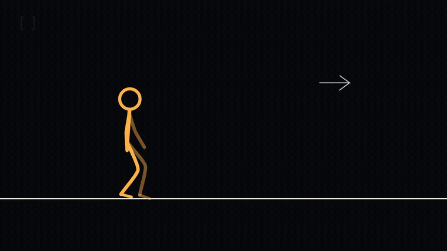
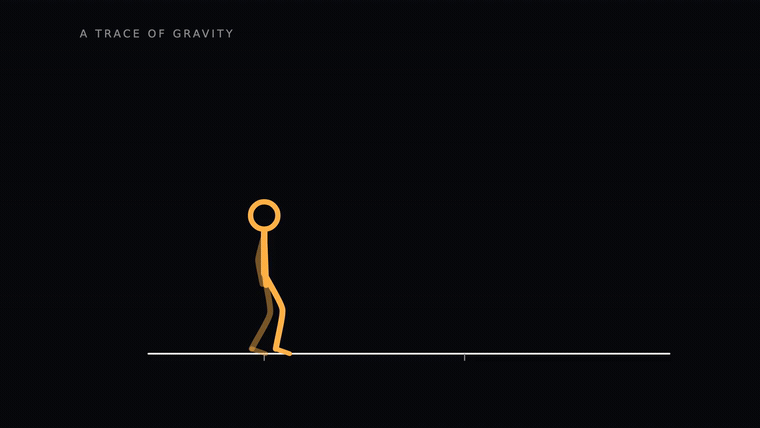
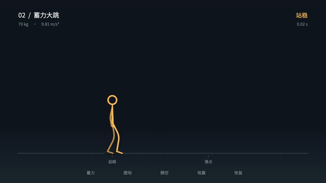

# stickman-motion-skill

**让知识成为角色可以操作的世界规则。**

面向 Codex 等支持 Agent Skills 的工具，以有动机、有判断力的火柴人为主角，通过选择、动作与世界反馈，将数学、物理或算法概念组织成动作冒险动画。

An Agent Skill for wordless stick-figure adventures where knowledge becomes an interactive world, with a TypeScript action film, weighted motion tools and reusable video export.

[技能入口](SKILL.md) · [设计分析](docs/design-analysis.md) · [制作与复现](demos/README.md) · [验证记录](demos/QA.md) · [参与贡献](CONTRIBUTING.md)

## 0.12.0：《怎么又是这里》· 牛顿迭代

使用新编剧提示词完成的首支新题材成片：**82 秒 / 720p / 60 fps / 无台词、有声**。主角先借切线前行，发现自己困在 0 与 1 的循环里；摔落后，他沿轴探索另一支曲线，再用早先留下的短线钩住输入，主动把起点移到 −2。


[完整有声 MP4](demos/newton/newton.mp4) · [逐段剧本与收敛推导](examples/newton-guide.md) · [可编辑 TS 工程与复现](demos/newton/README.md) · [编码后关键帧](demos/posters/newton-contact-sheet.jpg) · [实际 QA](demos/newton/QA.md)

复用 Motion Canvas 曲线、固定骨长、重力跳跃、步态拟音及共享导出。函数保持不变，编辑初始值时暂停求值；有限次结果使用近似符号。当前完成自动播放、数值与关键帧检查，主观完整听审和观众理解测试尚未完成。

```sh
python scripts/init_web.py output/my-newton --scene newton
npm --prefix output/my-newton/motion ci
npm --prefix output/my-newton/motion run prepare:audio
npm --prefix output/my-newton/motion run dev
# 打开终端地址的 /newton.html
```

## 0.11.0：原片仿写专用提示词

新故事默认直接使用 [《Animation vs. Math》仿写提示词 A/B/C](references/reference-screenwriting-prompts.md)：A 构思具体遭遇，B 写动作和声画脚本，C 按原片处理方式审改。要求稿子实际出现符号本体的手部操作、同一对象主动回应、相接攻防、重新探索得到的新表示及其后段用途，并回到同一对象的近距离互动。

[投影题材文本试写](examples/reference-prompt-trial.md) 展示了实际生成的故事、关键场面、对应关系和自审修正。这是文本试写，尚无新动画、观众理解测试或独立 agent 评价。

```text
使用 $stickman-motion-skill，主题【主题】，大致【时长】。
严格使用原片仿写提示词 A/B，连续完成故事与制作脚本。
按六项声画字段写具体场面，附原片处理方式对应表和数学/故事边界。
```

## 0.10.0：把原片的故事设计沉淀为编剧方法

重新拆解 [原片的悬念、对象变化、对抗与后段回收](docs/reference-story-analysis.md)，重写 [剧本开发方法](references/cinematic-storytelling.md)，新增 [快速剧本工作台](references/story-workbench.md)。新故事先写因果梗概与观众期待，再写动作分镜、铺垫回收与规则边界。

当前三支 0.9.0 视频保留为工程与动作样片；用户已反馈剧本不足，具体复盘见 [三片回看](docs/reference-story-analysis.md#9-对本项目三个-demo-的回看)。后续创作不能仅复用“发现机关—试用—熟练完成”的走向。该轮更新是编剧方法与文档，尚未通过新成片或观众测试验证叙事效果。

```text
使用 $stickman-motion-skill，围绕【主题】写一支【大致片长】的无台词故事。
先设计异常现象、人物选择和世界回应，让核心概念决定重要转折，
同一对象或规则在后段获得新的作用。按剧本工作台交付因果梗概、
制作分镜、铺垫回收与规则边界，先修正最弱的重复或无来源转折。
```

## 0.9.0：先有疑问，再发现规则

三支 demo 已按 [探索剧本](examples/demo-redesign.md) 重新制作。**TypeScript / Motion Canvas · 250 秒 / 15000 帧 · 720p / 60 fps · 无台词、有声**。从一个陌生对象开始，角色靠观察、触碰、判断和身体行动逐步理解世界；原有的出口、电芯和预铺关卡已移除。

### 01 · 《别追，等它回来》· 75 秒

追着箭头伸手，却被第一次反向带倒。揉过手腕后，他再次确认规则，登上箭身感受速度，再跑到前侧蓄力、起跳拨片，等返向的箭头接住自己。负号改变方向设置，实际运动经过减速和反转。


[完整有声 MP4](demos/videos/negative-ride.mp4) · [规则卡](examples/negative-ride.yaml) · [编码后关键帧](demos/posters/negative-ride-contact-sheet.jpg)

### 02 · 《谁在敲门》· 85 秒

小白框被敲两下后，暗处传来回应。沿接缝展开有序通口，提起薄框后才发现地址 63；四次查询找到匹配位置，伸进去的手竟从手里的框出现。结尾的敲击解释开场的声音来源。


[完整有声 MP4](demos/videos/binary-search.mp4) · [规则卡](examples/binary-search.yaml) · [编码后关键帧](demos/posters/binary-search-contact-sheet.jpg)

### 03 · 《世界的侧面》· 90 秒

白杆上的 `i` 夹片让他意外离地。他抓紧、试着找支撑、看回原处，再主动验证；横向换手攀近支点，完成后两次旋转，翻身上杆、接跑跳回。四段轨迹走完，才出现完整的圆。


[完整有声 MP4](demos/videos/complex-rotation.mp4) · [规则卡](examples/complex-rotation.yaml) · [编码后关键帧](demos/posters/complex-rotation-contact-sheet.jpg)

[三支连续观看](demos/tooling/edited-showcase.mp4) · [实际分镜与公共模块](demos/PRODUCTION.md) · [复现命令](demos/README.md) · [实际 QA](demos/QA.md)。共 555 个声音事件，包含接触拟音、回应、机关和原创程序音乐；浏览器与导出使用同一时间线和混音器。复用 `acting.ts` 的观察、抓握、悬挂、攀移和恢复姿态，配合既有步态、重力跳跃与固定骨长。

这是手工编排的侧视故事实现；没有通用人体动力学或任意提示词自动成片。参考作品的视觉与叙事语法已转化为自己的剧情、画面和声音，不宣称逐帧复制或达到原片的表演水平。主观完整观片、听审与观众理解测试分别记录，详见 QA。

## 0.7.0：正常速度动作与接触拟音

新增 **11 秒 / 60 fps 有声试片《断点》**：走、跑、冲刺、助跑跳、绊倒、手掌保护、收身滚翻、起身接跑、穿门制动和回看。动作衔接保留动量，执行段按正常速度编排。



[有声 MP4](demos/action/breakpoint.mp4) · [关键帧与实际 QA](demos/action/QA.md) · [动作与拟音方法](references/action-and-foley.md)

46 个声音事件与实际接触同步。不同步态有各自的步频与力度；脚步、碰撞和布料使用 Kenney CC0 素材，气流、呼吸和报警由程序合成。有声网页与 MP4 共用混音器，默认 1×。

```sh
python scripts/init_web.py output/my-action --scene action
npm --prefix output/my-action/motion ci
npm --prefix output/my-action/motion run prepare:audio
npm --prefix output/my-action/motion run dev
# 打开终端地址后的 /action.html，点击播放启用声音
```

首次素材准备需要联网和 FFmpeg，后续复用校验缓存。Git 保留许可、来源指纹和准备脚本，音效源文件留在本地；成片已包含声音。当前覆盖单人侧视路线与编排跌滚，未实现任意人体碰撞或双人武打。

## 0.6.0：接入曲线与数学排版库

新增 **Motion Canvas + TypeScript** 工程，使用 Spline / Bézier 构建柔和轮廓和示意曲线，使用 LaTeX 节点制作子式变形。继续复用重量、固定骨长、承重、重力轨迹与弹性落地，图形库负责呈现。



[18 秒 / 60 fps 有声试片](demos/geometry/trace.mp4) · [实际检查](demos/geometry/QA.md) · [数学图形方法](references/math-graphics.md) · [工程说明](motion/README.md)

这是曲线、公式与既有动作模型的**技术试片**，不是新的完整冒险剧本。《借势》保留原 Canvas 实现；三个概念主题已在 0.9.0 用 Motion Canvas 重拍。检查范围分别记录，不以库名代替实际评估。

```sh
python scripts/init_web.py output/my-film
npm --prefix output/my-film/motion ci
npm --prefix output/my-film/motion run dev
# 打开终端地址后的 /preview.html
```

新数学动画默认从此入口改编；`--engine canvas --scene adventure` 仍创建《借势》工程。两种入口共用声音与视频编码，支持局部试做、失败保护、片长与指纹记录。当前试片以两倍画布绘制，再缩为 720p；几何、速度、采样与符号连续性分开检查，不把库名或帧率当作质量结论。

## 0.5.0：让符号进入动作

新默认方向是极简黑色空间、白色知识对象、橙色主角与无台词行动叙事。人物直接拿取、组合和使用知识对象；规则反馈改变处境，镜头与声音跟随操作、受力和判断。详细制作判断见 [参考风格语法](references/reference-style.md)。

新增 **28 秒 / 60 fps 的 TS 原创短片《借势》**：拿取方向因子，登上移动支撑，装入乘法槽后承受反向加速，最后继承载体速度跳离。画内没有讲解面板，保留探索、执行、吸震与余波。


[有声 MP4](demos/adventure/reversal.mp4) · [规则与剧本](examples/reversal-adventure.md) · [关键帧与实际 QA](demos/adventure/QA.md) · [TS 接口与复用](references/ts-production.md)

新增可复用的承重步态、移动支撑转移、腕部抓取、上身姿态继承、相机轨道和三层事件声音。预览与导出共用画面函数，局部试做保留原场景时间与声音尾部。创建独立工程：

```sh
python scripts/init_web.py output/my-film --scene adventure
npm --prefix output/my-film/web ci
npm --prefix output/my-film/web run dev
# 在终端显示的地址后打开 /film.html
```

这是单人、同高支撑、单机制短片的实际实现；尚未覆盖原片的大型对抗、复杂空间演化、翻滚和双人动作，也没有把旧三支影片迁移到 TS。检查记录分别说明数值约束、浏览器、编码和审看的范围，不宣称仅凭这些检查达到参考作品的表演水平。

## 新增：像电影主角一样行动

0.4.0 更新剧本与表演方法：主角有具体动机、判断力和身体边界；情节由选择、条件变化及后果推进。通过头部定向、肩髋关系、重心、接触和停顿表达心理，重点动作有清楚的目的、路线与代价。

[电影式主角与因果剧本](references/cinematic-storytelling.md) · [《折返》90 秒完整例稿](examples/return-crossing.md) · [表演与制作](references/production-guidance.md)

《折返》讲两名检修员借单人吊架撤离：主角先送腿伤同伴过岸，平台继续断裂后，必须按受伤后的身体条件改变登架方式。它包含完整场景稿、空间和设备规则、关键选择依据及待验证项；**目前是文字例稿，尚无对应分镜或成片**。现有三支概念片保留原有规格，主要验证机制和工具链，尚未按这套剧本方法重拍。

## 新增：重量与弹性动作研究

0.3.0 增加 **TypeScript + Canvas 网页动作引擎**。角色先下蹲蓄力，蹬地做功决定起跳速度；腾空使用重力轨迹，落地保留下落动量，通过压缩、回弹和阻尼恢复。固定骨长与脚尖支撑配合躯干、头和摆臂的跟随。



[15.583 秒 / 60 fps 完整对照视频](demos/weight/weight-study.mp4) · [网页工程与启动命令](web/README.md) · [原片动作研究](docs/weight-motion-study.md) · [模型与复用接口](references/weighted-motion.md) · [实际检查记录](demos/weight/QA.md)

三个预设比较自然跳跃、蓄力大跳和同样发力下更重的身体。网页可实时调参、慢放、拖帧与显示受力；同一套绘制函数导出视频，附参数和文件指纹。只启动预览需要 Node.js 22.12+：

```sh
npm --prefix web ci
npm --prefix web run dev
```

这是有效质量驱动、结合关节表演的动画模型，尚非完整人体物理模拟。当时的三个概念案例使用 Python 引擎；0.8.0 已重新编写并以 TS 重拍，旧引擎作为历史参考保留。

## 核心方法

角色处境与动机 → 观察和选择 → 行动与世界反馈 → 条件变化或新的发现 → 调整 → 回收与余波。具体结构按题材选择，不强制角色先误操作再学习。

- **概念机制**：把知识写成可操作的规则，并说明前提和隐喻边界。
- **人物与剧本**：关键选择符合已知信息、性格和能力，失败有原因，高潮有铺垫。
- **动作表演**：通过注意、重心、接触、发力和反应表达心理；帅感来自动作目的、时机与控制。
- **符号与空间**：区分表达式编辑、求值、等价变形和空间隐喻。
- **制作与验收**：用统一时间线组织画面与声音，同时核验因果、数学与可读性。

适用于概念冒险、无台词叙事、知识关卡和对应的视频制作；普通口播配图或纯公式推导可以采用更简单的流程。

## 在 Codex 中安装

```sh
mkdir -p "$HOME/.agents/skills"
git clone https://github.com/okeeper/stickman-motion-skill.git \
  "$HOME/.agents/skills/stickman-motion-skill"
```

项目内使用时，也可以克隆到该项目的 `.agents/skills/stickman-motion-skill`。目录已存在时请更新已有安装，避免重复克隆。Codex 会发现技能变化；未显示时重启 Codex。路径及发现规则见 [OpenAI 官方技能文档](https://learn.chatgpt.com/docs/build-skills)。

```sh
git -C "$HOME/.agents/skills/stickman-motion-skill" pull --ff-only
```

安装技能不需要渲染依赖。需要重新渲染示例时，按下面的命令配置环境。

## 复现视频

需要 Node.js 22.12+、Python 3.10+、FFmpeg / ffprobe 和 Chromium。首次准备 CC0 音效需要联网，后续导出使用本地素材，不需要 API key。

```sh
npm --prefix motion ci
npm --prefix motion run prepare:audio
cd motion
npx playwright install chromium
npm run render:series
npm run dev
# 打开 /negative-ride.html、/binary-search.html、/complex-rotation.html
```

MP4 输出到 `demos/videos/`。关键帧、GIF、局部试做、独立工程和历史 Python 的区别见 [制作与复现](demos/README.md)。

## 可复用制作与剪辑工具

新增统一 CLI，将工程初始化、局部渲染、剪辑、检查与交付串起来：

```sh
python scripts/motion.py doctor
python scripts/motion.py init output/my-film --demo complex-rotation
python output/my-film/scripts/motion.py render output/my-film/project.json \
  --profile preview --start 10 --end 14 --out output/my-film/renders/preview.mp4
python scripts/motion.py edit examples/edit-showcase.json --plan
python scripts/motion.py edit examples/edit-showcase.json
python scripts/motion.py inspect demos/tooling/edited-showcase.mp4 --out output/review
python scripts/motion.py deliver demos/tooling/edited-showcase.mp4 --out output/delivery
python scripts/motion.py verify output/delivery
```

支持裁切、变速且保持音高、统一画幅和帧率、硬切/淡化、原声增益、多音轨混音与 SRT 软字幕。按内容指纹复用未改片段，编码成功后原子替换成片；新工程复制所需工具与字体，可以独立运行。

[完整工具说明](references/tooling.md) · [剪辑示例](examples/edit-showcase.json) · [剪辑成片与实测记录](demos/tooling/README.md) · [更新记录](CHANGELOG.md)

工程分层、联系表与交付记录参考了 huashu-art-motion；直接复用范围与许可见 [复用记录](docs/upstream-reuse.md)。视觉设计继续使用本项目自己的火柴人和概念交互方式。

## 使用 Skill

```text
使用 $stickman-motion-skill，先写一个 90 秒无台词动作剧本：两个人要穿过
一处正在失稳的空间，主角有身手，也会谨慎判断、保护同伴和承担代价。
让重点动作服务于脱困，用身体行为表达心理。交付完整场景、关键选择
依据和动作路线；此轮只写剧本，不把文字例稿当成已经制作的视频。
```

```text
使用 $stickman-motion-skill，把“负数乘法与方向反转”做成一支无台词
火柴人故事。从陌生箭头的试探开始，让角色通过反馈发现规则并改变行动。
交付可播放视频、可编辑工程、规则卡和实际检查记录。
```

```text
使用 $stickman-motion-skill，参考仓库的二分查找 demo，设计一个关于
“栈的后进先出”的新故事。先确定角色处境、合理选择和可见反馈，
再实现一个完整的短片；不要只替换标题或把现成视频当作新产物。
```

```text
使用 $stickman-motion-skill，分析我提供的视频：提取角色表演、概念交互、
镜头和节奏规则，区分实际观察与实现建议，并标出无法验证的部分。
```

## 开发与检查

```sh
python scripts/validate.py
python -m unittest discover -s tests -v
npm --prefix web ci
npm --prefix web run build
npm --prefix web test
# 浏览器检查另需安装 Chromium：cd web && npx playwright install chromium
npm --prefix web run test:browser
npm --prefix web run test:adventure
npm --prefix motion ci
npm --prefix motion run build
npm --prefix motion run prepare:audio
npm --prefix motion test
# 同样需要 Chromium；浏览器二进制可在两工程间共用
npm --prefix motion run test:browser
npm --prefix motion run test:action
npm --prefix motion run test:series
```

文档与规则卡检查仅需要 `requirements-dev.txt`；Python 动画、音频测试需要 `requirements-render.txt`。CI 执行结构检查、Python 行为和真实 FFmpeg 回归，以及两种 TS 工程的构建、几何、物理和浏览器交互检查，不重复渲染三支完整概念片。

```text
SKILL.md                         技能入口
motion/                          Motion Canvas 曲线、LaTeX、预览与视频导出
web/                             TS 重量、连续表演、概念冒险与共享声音/编码
references/                      规则卡、表演与制作指南
examples/                        规则卡与剧本，含各 demo 的输入任务
demos/                           MP4、GIF、分镜与验证记录
scripts/demo_engine/             人物、几何、场景状态与原创声音
scripts/render_demo.py           历史 Python 案例渲染（默认 output/legacy-demos/）
scripts/check_demo_media.py      当前三支成片的解码、时长与音轨检查
scripts/series_previews.py       从实际 MP4 重建 GIF、海报和关键帧图
scripts/motion.py                可复用工具入口
scripts/init_web.py              独立 TS 工程初始化
scripts/prepare_audio.py         校验来源并准备本地 CC0 拟音缓存
scripts/motion_tools/            工程、剪辑、媒体与交付模块
assets/project/                  独立工程的场景入口模板
tests/                           概念、接触、确定性和失败输入检查
assets/fonts/                    字体与原始许可证
```

## 后续方向

- [x] 用三支原创短片验证符号操作、算法决策和空间变换。
- [x] 提供可复现工程、原始任务、规则卡、关键帧和成片检查。
- [x] 提炼可复用的人物、接触、时间线与声音模块。
- [x] 增加重量、蓄力、重力轨迹与弹性落地的 TS 动作研究及浏览器调参。
- [x] 更新电影式主角、合理决策与无表情表演方法，完成《折返》文字例稿。
- [x] 把参考片语法落实到 TS《借势》：直接符号操作、移动支撑、连续动作、相机与事件声音。
- [x] 接入 Motion Canvas、曲线与 LaTeX 子式动画，完成技术试片和独立工程模板。
- [ ] 用动态分镜和实际影片验证《折返》的双人判断、肢体可读性和动作节奏。
- [x] 将三支概念故事重拍为 TS 动作短片，复用跑步、支撑转移、平衡与接触拟音。
- [ ] 继续扩展双人交互、复杂搬运和多处支撑的动作模型。
- [ ] 增加更丰富的身体表演、动作过渡与镜头尺度变化。
- [ ] 增加非数学题材，并进行静音理解度测试。
- [ ] 根据更多实测场景决定哪些参数值得形成稳定配置接口。

## 参考与许可

设计研究参考 [Alan Becker 的《Animation vs. Math》](https://www.youtube.com/watch?v=B1J6Ou4q8vE)。本项目与原作者无隶属关系；新示例为独立设计，没有分发原片画面、角色素材、截图或音轨。

原创文档、规格、代码和 demo 媒体采用 [MIT License](LICENSE)。字体保留独立许可证，见 [第三方说明](THIRD_PARTY_NOTICES.md)。
