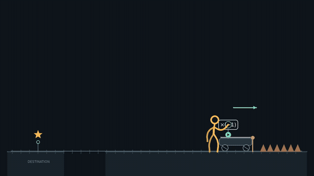
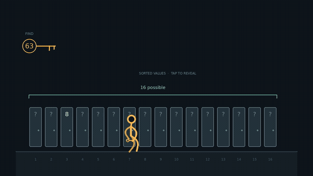
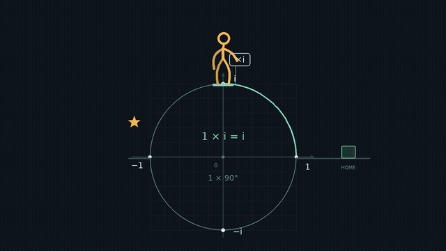

# stickman-motion-skill

**让知识成为角色可以操作的世界规则。**

面向 Codex 等支持 Agent Skills 的工具，用火柴人的操作、试错与发现，将数学、物理或算法概念组织成动作冒险动画。

An Agent Skill for turning concepts into stick-figure adventures through interaction, experimentation, and discovery — with three runnable, original demo films.

[技能入口](SKILL.md) · [设计分析](docs/design-analysis.md) · [制作与复现](demos/README.md) · [验证记录](demos/QA.md) · [参与贡献](CONTRIBUTING.md)

## 先看三个 Demo

每支 **36 秒，1280×720，30 fps，无台词，含原创合成音乐与音效**。下面是 12 秒无声 GIF 摘录，完整 MP4 包含开端、试探和结果。

### 01 · 反向才到达

角色要去左边，运载车却朝右。三次触碰 `×(-1)`，让“负数乘法”变成试错、观察和主动复用。



[完整 MP4](demos/videos/negative-ride.mp4) · [任务与规则卡](examples/negative-ride.yaml) · [关键帧](demos/posters/negative-ride-contact-sheet.jpg)

### 02 · 只留下一半

十六扇门的值按升序排列，需要查询后才揭晓。角色寻找 63，候选区间随着比较从 16 缩至 8、4、1，展示算法如何改变下一步行动。



[完整 MP4](demos/videos/binary-search.mp4) · [任务与规则卡](examples/binary-search.yaml) · [关键帧](demos/posters/binary-search-contact-sheet.jpg)

### 03 · 四分之一圈

角色乘坐 `×i` 载台，沿单位圆取物并回家。四次逆时针转动留下完整轨迹，最后得到 `i⁴ = 1`。



[完整 MP4](demos/videos/complex-rotation.mp4) · [任务与规则卡](examples/complex-rotation.yaml) · [关键帧](demos/posters/complex-rotation-contact-sheet.jpg)

## 这些示例验证什么

| 示例 | 核心能力 | 必须保持的边界 |
|---|---|---|
| 反向才到达 | 符号操作、预备动作、接触、试错和复用 | 面板是下一次运行的速度设置，停车时不代表实际速度 |
| 只留下一半 | 算法状态、候选范围、比较后的方向决策 | 门退场表示排除候选，不删除或重排原数组 |
| 四分之一圈 | 参数化几何、空间路径、携带与闭环 | 中间旋转是展示插值，完成后才显示乘法结果 |

三支样片共用骨架绘制、手部接触、绝对时间求帧和音效模块。它们是专门编写的参考实现；新增题材仍需要规则卡、分镜与场景代码，当前不支持把任意提示词或 YAML 直接变成视频。

自动检查、关键帧及连续抽帧的检查范围见 [QA 记录](demos/QA.md)。这些早期样片尚未经过观众理解度测试，不能据此声称达到参考作品的表演或叙事水平。

## 核心方法

角色目标 → 操作对象 → 规则反馈 → 意外或误判 → 理解 → 主动复用。

- **概念机制**：把知识写成可操作的规则，并说明前提和隐喻边界。
- **动作表演**：通过姿态、接触、发力和反应表达角色心理。
- **符号与空间**：区分表达式编辑、求值、等价变形和空间隐喻。
- **制作与验收**：用统一时间线组织画面与声音，同时核验因果、数学与可读性。

适用于概念冒险、无台词叙事、知识关卡和对应的视频制作；普通口播配图或纯公式推导可以采用更简单的流程。

## 在 Codex 中安装

```sh
mkdir -p "$HOME/.agents/skills"
git clone https://github.com/okeeper/stickman-motion-skill.git \
  "$HOME/.agents/skills/stickman-motion-skill"
```

项目内使用时，也可以克隆到该项目的 `.agents/skills/stickman-motion-skill`。目录已存在时请更新已有安装，避免重复克隆。Codex 会发现技能变化；未显示时重启 Codex。路径及发现规则见 [OpenAI 官方技能文档](https://learn.chatgpt.com/docs/build-skills)。

```sh
git -C "$HOME/.agents/skills/stickman-motion-skill" pull --ff-only
```

安装技能不需要渲染依赖。需要重新渲染示例时，按下面的命令配置环境。

## 复现视频

需要 Python 3.10+，以及 PATH 中的 `ffmpeg` 和 `ffprobe`。渲染不调用外部模型或网络，不需要 API key。

```sh
python3 -m venv .venv
. .venv/bin/activate
python -m pip install -r requirements-render.txt
python scripts/render_demo.py --scene all
python scripts/render_demo.py --gifs-only
python scripts/check_demo_media.py --report demos/media-check.json
```

只渲染一支：`python scripts/render_demo.py --scene complex-rotation`。文件输出到 `demos/videos/`，海报与关键帧输出到 `demos/posters/`。更多预览命令、场景结构与改编步骤见 [制作与复现](demos/README.md)。

## 可复用制作与剪辑工具

新增统一 CLI，将工程初始化、局部渲染、剪辑、检查与交付串起来：

```sh
python scripts/motion.py doctor
python scripts/motion.py init output/my-film --demo complex-rotation
python output/my-film/scripts/motion.py render output/my-film/project.json \
  --profile preview --start 10 --end 14 --out output/my-film/renders/preview.mp4
python scripts/motion.py edit examples/edit-showcase.json --plan
python scripts/motion.py edit examples/edit-showcase.json
python scripts/motion.py inspect demos/tooling/edited-showcase.mp4 --out output/review
python scripts/motion.py deliver demos/tooling/edited-showcase.mp4 --out output/delivery
python scripts/motion.py verify output/delivery
```

支持裁切、变速且保持音高、统一画幅和帧率、硬切/淡化、原声增益、多音轨混音与 SRT 软字幕。按内容指纹复用未改片段，编码成功后原子替换成片；新工程复制所需工具与字体，可以独立运行。

[完整工具说明](references/tooling.md) · [剪辑示例](examples/edit-showcase.json) · [剪辑成片与实测记录](demos/tooling/README.md) · [更新记录](CHANGELOG.md)

工程分层、联系表与交付记录参考了 huashu-art-motion；直接复用范围与许可见 [复用记录](docs/upstream-reuse.md)。视觉设计继续使用本项目自己的火柴人和概念交互方式。

## 使用 Skill

```text
使用 $stickman-motion-skill，把“负数乘法与方向反转”做成 36 秒的无台词
火柴人故事。让角色先误判、再验证规则，最后通过同一规则完成目标。
交付可播放视频、可编辑工程、规则卡和实际检查记录。
```

```text
使用 $stickman-motion-skill，参考仓库的二分查找 demo，设计一个关于
“栈的后进先出”的新故事。先确定角色目标、错误尝试和可见反馈，
再实现一个完整的短片；不要只替换标题或把现成视频当作新产物。
```

```text
使用 $stickman-motion-skill，分析我提供的视频：提取角色表演、概念交互、
镜头和节奏规则，区分实际观察与实现建议，并标出无法验证的部分。
```

## 开发与检查

```sh
python scripts/validate.py
python -m unittest discover -s tests -v
```

文档与规则卡检查仅需要 `requirements-dev.txt`；动画、音频测试需要 `requirements-render.txt`。CI 自动执行结构检查、行为测试与真实 FFmpeg 剪辑/独立工程回归，不重复渲染三支完整样片。

```text
SKILL.md                         技能入口
references/                      规则卡、表演与制作指南
examples/                        四份故事规格，含三支 demo 的输入任务
demos/                           MP4、GIF、分镜与验证记录
scripts/demo_engine/             人物、几何、场景状态与原创声音
scripts/render_demo.py           确定性渲染与预览导出
scripts/check_demo_media.py      三支原始 demo 的规格检查
scripts/motion.py                可复用工具入口
scripts/motion_tools/            工程、剪辑、媒体与交付模块
assets/project/                  独立工程的场景入口模板
tests/                           概念、接触、确定性和失败输入检查
assets/fonts/                    字体与原始许可证
```

## 后续方向

- [x] 用三支原创短片验证符号操作、算法决策和空间变换。
- [x] 提供可复现工程、原始任务、规则卡、关键帧和成片检查。
- [x] 提炼可复用的人物、接触、时间线与声音模块。
- [ ] 增加更丰富的身体表演、动作过渡与镜头尺度变化。
- [ ] 增加非数学题材，并进行静音理解度测试。
- [ ] 根据更多实测场景决定哪些参数值得形成稳定配置接口。

## 参考与许可

设计研究参考 [Alan Becker 的《Animation vs. Math》](https://www.youtube.com/watch?v=B1J6Ou4q8vE)。本项目与原作者无隶属关系；新示例为独立设计，没有分发原片画面、角色素材、截图或音轨。

原创文档、规格、代码和 demo 媒体采用 [MIT License](LICENSE)。字体保留独立许可证，见 [第三方说明](THIRD_PARTY_NOTICES.md)。
