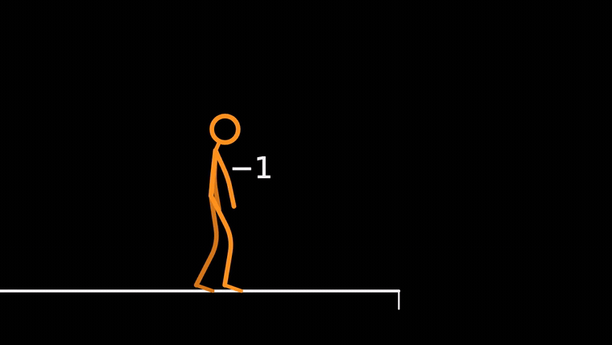

# 《借势》：TS 概念冒险样片

28 秒、1280×720、60 fps、无台词，含原创合成音乐和音效。人物拿取方向因子，登上移动支撑后装入乘法槽，承受反向加速，再借已有速度越过剩余空隙。它把符号操作放进身体行动，采用黑色留白、白色对象、橙色角色和有动机的镜头尺度变化。



[有声 MP4](reversal.mp4) · [实际导出记录](reversal.json) · [规则卡与剧本](../../examples/reversal-adventure.md) · [关键帧](keyframes.jpg) · [实际 QA](QA.md)

## 复现与改编

仓库根目录运行：

```sh
npm --prefix web ci
npm --prefix web run dev
# 在终端显示的地址后打开 /film.html
npm --prefix web run render -- --scene adventure --fps 60
npm --prefix web run render -- --scene adventure --fps 30 --from 7 --to 9.5 --out ../output/boarding.mp4
```

需要 Node.js 22.12+、FFmpeg/ffprobe 与 Chromium；浏览器可通过 `MOTION_BROWSER_EXECUTABLE` 指定。预览支持原速、慢放、拖帧、动作节点与接触检查；网页为静音预览，MP4 含声音。`web/dist/film.html` 是构建后的入口。

其他 agent 创建独立工程：

```sh
python scripts/init_web.py output/my-film --scene adventure
npm --prefix output/my-film/web ci
```

具体接口见 [TS 制作与复用](../../references/ts-production.md)。新主题需要重写人物目标、规则与动作，现有源码不是任意主题的一键生成器。

## 数学与动作

`d′=−d` 改变平台的电机方向设置，实际速度连续制动后反向；方向设置与实际速度不是同一变量。人物腾空受重力影响，离开移动平台继承其水平速度，落地保留速度并通过阻尼恢复。符号抓取绑定实际腕部，承重脚绑定支撑。

采用有效质量、固定骨长与关节表演，尚非完整人体刚体模拟。它验证单人、同高支撑、一个机制的短片实现，没有覆盖参考片的大型对抗、复杂数学世界演化或完整角色关系。观感与听审的实际完成范围见 QA，不能仅凭黑橙配色、TS 或 60 fps 宣称达到原片水平。
