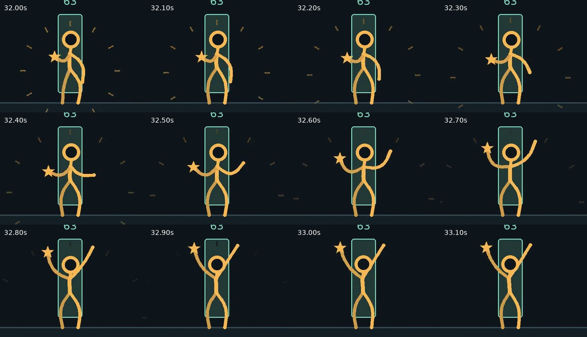

# 动作修正：关节、承重与过渡

[新旧放大对比 MP4](before-after.mp4) · [当前 TS 重拍版二分查找](../videos/binary-search.mp4) · [媒体检查](media-check.json) · [骨架与编排接口](../../references/character-motion.md)

本页保留 0.2.1 的 Python 历史动作对比；当前同名概念片已在 0.8.0 重拍为 18 秒。下述时间戳只针对本页对比文件。

对比取自二分查找的 **28–36 秒**，左右均为原速、30 fps、相同裁切与放大比例。左侧是修改前的 0.2.0，右侧是本次 0.2.1。内容包括伸手、取物、向前走和庆祝；与反馈截图中的结尾动作对应。旧版本视频来自本仓库提交 `55bce823c79c9123e180f367d2af7be31848952f`，未使用参考作品画面。

修正涉及整套人物引擎，因此三支样片及通用剪辑合辑均已重新生成：

- 肘、膝和躯干采用圆滑曲线；站姿不再出现交叉的 X 形腿。
- 姿态通过权重进入和退出，起跳、落地、转身、思考和庆祝都有连续过渡。
- 走路时支撑脚锁住世界坐标，摆动脚沿抬脚轨迹前进；停止时完成落脚。
- 庆祝时保留承重，通过上身、头部和双臂的不同相位形成变化。
- 按钮和取物使用同一套手部约束，避免姿态自然了但接触脱开。

画面检查包括放大姿态和编码后连续抽帧；自动检查见 [动作测试](../../tests/test_motion.py) 和 [全片 QA](../QA.md)。未将全片正常速度的人工观片、听审标记为完成。卡通骨架允许局部透视缩短，并非完整的人体动力学仿真。

复核时重点看接触之前和之后的过渡，不只看手恰好碰到目标的单帧。10 fps 的 README GIF 只用于预览封面和故事内容；判断动作节奏应使用 30 fps MP4。
