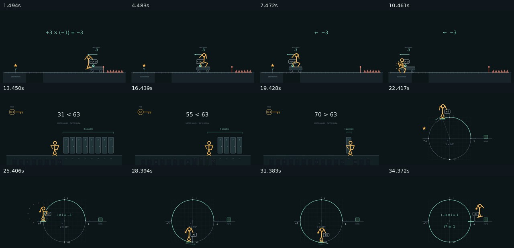

# 通用脚手架实测

[剪辑成片](edited-showcase.mp4) · [剪辑清单](../../examples/edit-showcase.json) · [中文字幕](../../examples/edit-showcase.srt) · [检查记录](review/QA.md)

这条合辑由三支已有原创 demo 剪辑而成，用于验证通用制作工具。画面沿用原作，剪辑参数集中在 JSON 清单中。

| 片段 | 原片区间 | 倍速 | 标准化后的时长 |
|---|---|---|---|
| 反向才到达 | 20–32 秒 | 1× | 12 秒 / 360 帧 |
| 只留下一半 | 10.5–30.5 秒 | 2× | 10 秒 / 300 帧 |
| 四分之一圈 | 10–32 秒 | 1.5× | 14.6667 秒 / 440 帧 |

两次 0.4 秒淡化，共扣除 24 帧，最终 **1076 帧 / 35.8667 秒，1280×720、30 fps**。原声音量降低 2 dB，末尾叠加来自本项目原声的完成提示。中文 SRT 封装为可选择的软字幕，需要在支持字幕的播放器中开启。



## 可复现命令

从仓库根目录执行：

```sh
python scripts/motion.py edit examples/edit-showcase.json --plan
python scripts/motion.py edit examples/edit-showcase.json
python scripts/motion.py inspect demos/tooling/edited-showcase.mp4 --out output/review
python scripts/motion.py deliver demos/tooling/edited-showcase.mp4 --out output/delivery-v1
python scripts/motion.py verify output/delivery-v1
```

交付目录需要不存在；再次运行时换一个目录名。完整字段与独立工程用法见 [工具说明](../../references/tooling.md)。

## 实际检查

- 实际 MP4 完整解码通过，帧数和时长符合计划；音轨峰值为 -16.175 dBFS，软字幕可以导出回 UTF-8 SRT。
- 复跑时三个标准化片段全部命中缓存；重新合成的 MP4 与先前文件 SHA-256 相同，见 [缓存结果](cache-check.json)。这证明本次运行的内容一致性，不保证不同 FFmpeg 版本编码字节相同。
- `deliver` 对复制后的成片重新检查，并生成包含 5 个文件的交付清单；`verify` 通过。汇总见 [validation.json](validation.json)。
- 查看了实际成片的 12 帧联系表；没有将正常速度人工观片或听审标记为完成。
- 原有 render_demo.py 入口以 negative-ride、15 fps、scale=1 实际输出 36 秒 / 540 帧，保留兼容。

## 回归覆盖

仓库共 18 个测试方法：原有 12 项概念/动作/声音测试，加上 6 项真实 FFmpeg 集成测试。新用例覆盖混合分辨率和帧率、竖屏留边、变速音高、静音补齐、三段淡化、额外音轨入点、中文与引号路径、软字幕、缓存失效、非法清单、编码失败保留旧成片、交付文件变化检测，以及独立工程在其他工作目录中的局部渲染和静帧输出。

本轮修复了 setpts 处理后帧率信息丢失导致的连续淡化失败，以及未明确编码帧率导致的末帧时长缺失；输入滤镜在时间调整后明确 fps，输出明确 CFR。模板导出的 DURATION 使用显式重导出，避免自动整理导入时误删场景契约。
