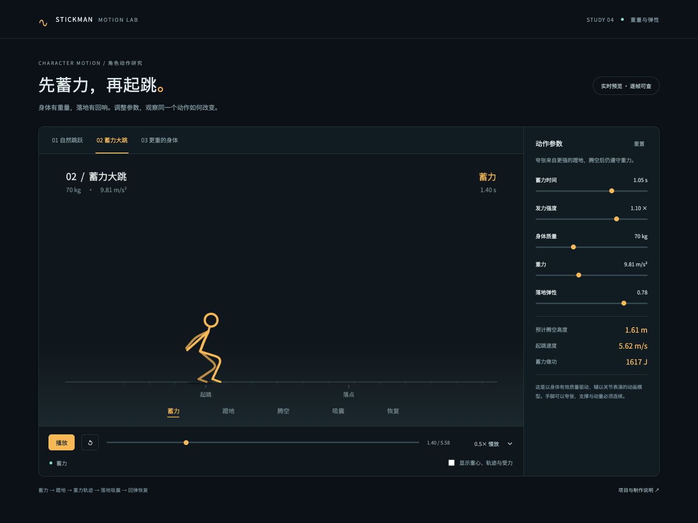

# Stickman Motion Lab

独立的 TypeScript + Canvas 动作工程：先蓄力，再蹬地，按重力轨迹腾空，落地压缩并逐渐恢复。提供自然跳跃、蓄力大跳和更重的身体三种预设。



## 启动与构建

需要 Node.js 22.12+。以下命令在仓库根目录执行：

```sh
npm --prefix web ci
npm --prefix web run dev
npm --prefix web run build
```

打开终端显示的本地地址。预览支持质量、重力、发力、蓄力和弹性调节，以及播放、慢放、拖帧与受力显示。`web/dist/` 是可独立部署的静态网站；字体随工程提供，浏览器运行时不请求外部服务，无需 API key。

## 导出实际视频

另需 PATH 中的 FFmpeg / ffprobe，以及 Playwright Chromium。安装浏览器后导出：

```sh
cd web
npx playwright install chromium
npm run render -- --preset all --out ../output/weight-study.mp4
npm run render -- --preset heroic --fps 60 --out ../output/heroic.mp4
npm run render -- --config ../examples/weight-jump.json --fps 30 --out ../output/custom.mp4
```

`--config` 接受包含五个参数的 JSON；见 [可运行配置](../examples/weight-jump.json)。它导出单个自定义动作；默认以“大跳”作为画面标签，可配合 `--preset natural|heroic|heavy` 选择已有标签。自定义故事需要修改绘制与场景代码，不能只换参数冒充新故事。

如使用已安装的 Chrome，可设置 `MOTION_BROWSER_EXECUTABLE` 为浏览器可执行文件的绝对路径，例如 macOS 的 `/Applications/Google Chrome.app/Contents/MacOS/Google Chrome`，无需再下载 Chromium。跨机器要得到一致的像素，须固定浏览器、字体及编码器版本；时间与物理状态本身不依赖渲染帧率。

导出使用与预览相同的绘制函数，支持 30/60 fps、1280×720，生成事件驱动的原创音效、H.264/AAC MP4 和同名 JSON 事实记录。失败时保留已有视频，成功后原子替换。JSON 记录参数、时刻、帧数、音频合成峰值和文件指纹；它不是视觉质量证书。

导出后继续复用原有剪辑与交付工具：

```sh
python scripts/motion.py inspect output/weight-study.mp4 --out output/review
python scripts/motion.py deliver output/weight-study.mp4 --out output/delivery
```

上面两条 Python 命令在仓库根目录执行。`motion.py init` 目前生成 Python 工程；不会自动生成此 Web 工程。开始独立的 TS 项目时，可复制 `web/` 中的源码、脚本、配置、锁文件、字体及许可，排除 `node_modules/`、`dist/`、`.test-build/`、`test-results/`，再运行 `npm ci`。任务内容应保存在用户项目目录，不写回 skill 安装目录。

## 模块与检查

| 文件 | 职责 |
|---|---|
| `src/physics.ts` | 蓄力做功、重力飞行、接触弹簧、固定步长状态与事件 |
| `src/rig.ts` | 固定骨长、脚尖支撑、脚跟转动、收腿、摆臂与头部跟随 |
| `src/render.ts` | Canvas 画面、相机、阴影、冲击点缀、调试信息 |
| `src/main.ts` | 调参、播放、时间轴和自动化帧接口 |
| `scripts/browser.mjs` | 启动本地网页与受控浏览器，收集资源与页面错误 |
| `scripts/audio.mjs` | 按起跳/碰撞事件生成确定性音效 |
| `scripts/render.mjs` | 逐帧导出、音画编码、验证帧数与输出指纹 |

```sh
npm --prefix web test
npm --prefix web run test:browser
npm --prefix web run format:check
```

浏览器检查需要上述 Chromium 或 Chrome 配置，截图和记录输出到忽略版本控制的 `web/test-results/`。物理回归检查和画面判断的边界见 [重量与弹性说明](../references/weighted-motion.md)。原片观察、工程参考与未覆盖的全身物理见 [研究记录](../docs/weight-motion-study.md)。
